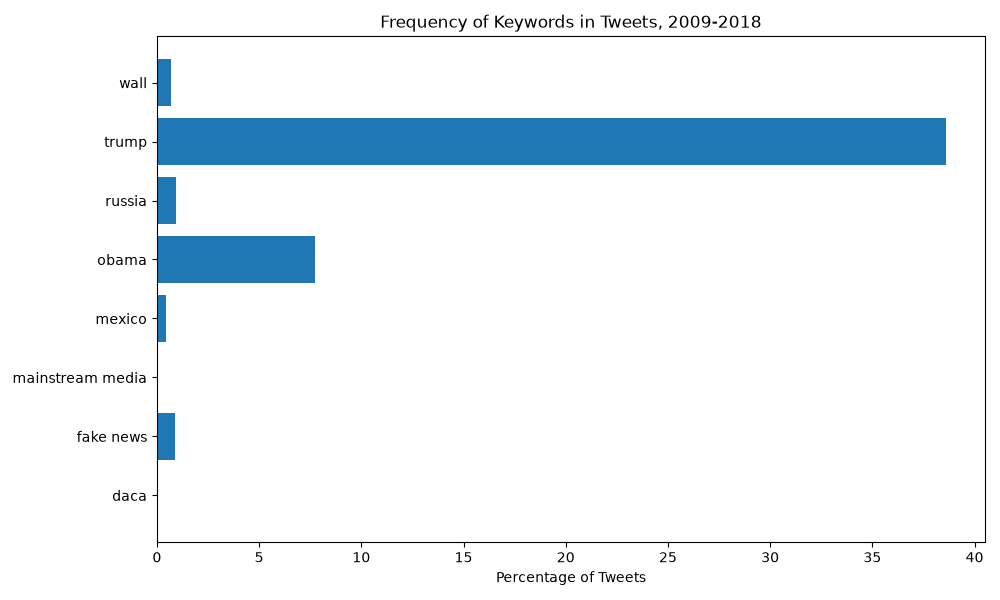

# [lab-web-data](https://csci40.rtealwitter.com/topics/05_web_scraping/lab.html)
# Tweet Phrase Counts
|           phrase | percent of tweets |
| ---------------- | --------------- |
|             daca | 00.05 |
|        fake news | 00.88 |
| mainstream media | 00.03 |
|           mexico | 00.45 |
|            obama | 07.73 |
|           russia | 00.91 |
|            trump | 38.58 |
|             wall | 00.68 |

Trump appears in far more tweets than any other phrases, which matches well with my prediction, which doesn't really surprise me because he has been a hot topic for a whole decade now, and form the data, he basically overruled the mentions compared to the others.